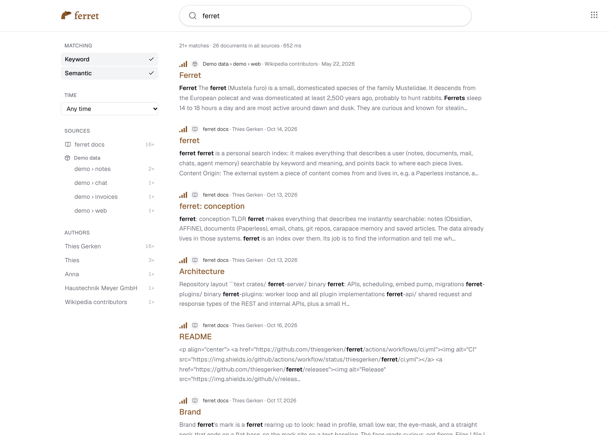
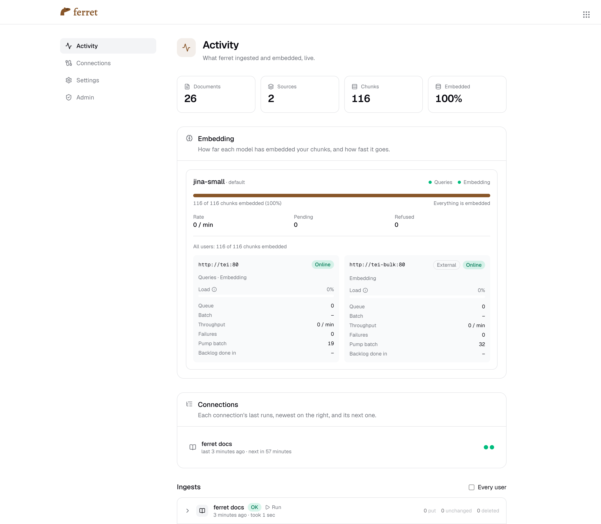

<p align="center">
  <a href="https://github.com/thiesgerken/ferret/actions/workflows/ci.yml"></a>
  <a href="https://github.com/thiesgerken/ferret/releases"></a>
  <a href="rust-toolchain.toml"></a>
  <a href="LICENSE"></a>
  <a href="charts/ferret/README.md"></a>
</p>

<p align="center">
  <picture>
    <source media="(prefers-color-scheme: dark)" srcset="docs/brand/logo-dark.svg">
    
  </picture>
</p>
<p align="center"><strong>A personal search index over everything that describes you.</strong></p>

<p align="center">Hybrid search. Deep links to the origin. One API for you and your agents.</p>

<p align="center">
  <a href="#-getting-started">🚀 Getting started</a>
  ·
  <a href="docs/conception/plugins.md">🔌 Plugins</a>
  ·
  <a href="docs/conception/architecture.md#apis">🤖 API</a>
  ·
  <a href="charts/ferret/README.md">⚓ Helm chart</a>
</p>

Your notes, documents, mail, chats and your agent's memory already live somewhere: Paperless, git,
a mailbox, carapace. ferret doesn't replace any of them. It is an **index** over all of them: one
search that finds what you wrote, shows the passage that matched, and links you straight back to
where it lives. Your agents get the same search through the same API, so they ask once instead of
guessing which tool's search to try first.

## ✨ Highlights

- 🔎 **Hybrid search that speaks German and English.** BM25 with German and English stemming plus
  trigrams for compounds, fused with multilingual embeddings. Switch either half off when you know
  what you want. The UI speaks both languages too.
- 🔗 **Find it here, open it there.** Every hit deep-links to its origin: the Paperless document,
  the file in your git forge or Obsidian vault, the carapace session. ferret keeps a copy to search
  it, never to become the place you read it.
- 🔌 **Plugins for your systems, a REST API for everything else.** git, Paperless and carapace sync
  on a schedule; IMAP and AFFiNE are coming. Anything else sends documents with a plain HTTP `PUT`.
- 🤖 **Your agent searches once.** One index over everything, so the cocktail question finds the
  recipe and the note about your home bar in the same query, and the agent knows where to dig
  deeper with that source's own tools. It's the search you use too. API keys are scoped to sources
  and to read or write, so an agent sees exactly what you hand it.
- ⚡ **Embeddings on your own hardware.** A pool of TEI servers, in the cluster and on your
  laptop's GPU for big backfills, switched on and off live from Admin. Activity shows the progress.
- ☸️ **Self-hosted, Kubernetes-native.** A Helm chart, Postgres (ParadeDB and pgvector) as the only
  store, secrets generated on install.

## 💡 Motivation

My personal agent ([carapace](https://github.com/thiesgerken/carapace)) often spends considerable
amounts of time, tokens and tool calls just to find out *where* to find stuff. And sometimes it
doesn't find it at all, even if the info is there. Sure, it has access to my recipes, DMs,
documents, emails, … and each of those has some kind of search function that might be good or not.
Mostly not. And even if: searching all of those in parallel is neither efficient nor what the agent
usually does. It either stops after the first okay-ish search result or finds nothing after
searching the wrong sources.

Example: searching for cocktail ideas, it goes immediately into my recipe tool, but does not think
about checking the document that says what I like and what is in my home bar. Sure, I can add a
skill or put explicit instructions into the agent's system prompt, but that is also not efficient,
cumbersome, and only works after I got frustrated at least once.

What I wanted was a "discovery tool": the agent gets a quick overview of what I already have
scattered around about a topic, and then uses dedicated skills to fetch more information from the
respective sources.

## 📸 Screenshots

<p align="center">
  
</p>

<p align="center"><em>Results with filters by source and author, relevance bars for both halves of the search, and a snippet that opens the document at the match.</em></p>

<br>

<p align="center">
  
</p>

<p align="center"><em>Activity: what's indexed and embedded, the TEI pool with an in-cluster server and an external one that only embeds, and every sync as it happens.</em></p>

## 🔌 Sources

| plugin | indexes | a hit links to |
| --- | --- | --- |
| git | Markdown and text files of a repository, e.g. an Obsidian vault | the file in your forge or vault, at its commit |
| Paperless | documents with their OCR text | the document in Paperless |
| carapace | facts, skills and archived sessions of a knowledge repository | the file or session in carapace |
| IMAP (coming) | a mailbox, with its threads kept together | the mail, e.g. as a `mid:` link |
| AFFiNE (coming) | the docs of a workspace | the doc in AFFiNE |

Everything else goes through the [ingest API](docs/conception/README.md#ingest-api): a `PUT` per
document with an API key, from a script, a cron job or an agent.

## 🚀 Getting started

```sh
docker compose up
scripts/demo-seed.sh
```

starts ferret on <http://127.0.0.1:3380> (sign in as `admin` with `ferret-development`) and fills it
with sample documents and a git connection to ferret's own docs. On Apple Silicon, see
[docs/development.md](docs/development.md) first.

For a real deployment, install the [Helm chart](charts/ferret/README.md).

## 🏗️ How it works

The server (Rust, axum) serves the UI's GraphQL API and the REST API, schedules plugin runs and
runs the embed pump. Plugin workers pull runs from the server and write through the same ingest API
anyone else uses. Postgres holds everything: documents, chunks, the BM25 index and the vectors. A
pool of TEI servers turns chunks and queries into embeddings. More in
[architecture.md](docs/conception/architecture.md).

## 📚 Docs

| topic | what it covers |
| --- | --- |
| [Conception](docs/conception/README.md) | what ferret is for, the data model, search, v1 scope |
| [Architecture](docs/conception/architecture.md) | components, APIs, plugin orchestration, deployment |
| [Users and auth](docs/conception/auth.md) | sessions, API keys and their scopes, plugin credentials |
| [Embeddings](docs/conception/embeddings.md) | models, the TEI pool, the embed pump, model evaluation |
| [Plugins](docs/conception/plugins.md) | the plugin contract and each plugin's sync |
| [Helm chart](charts/ferret/README.md) | installing ferret on Kubernetes |
| [Development](docs/development.md) | the compose stack, demo data, tests |
| [Glossary](docs/glossary.md) | the domain vocabulary |
| [ADRs](docs/adr/) | decisions and why they were made |
| [Brand](docs/brand/README.md) | the mark, the wordmark and their colours |

## 💬 Remarks

- Mandatory AI disclaimer: of course I use AI for coding, everything else just doesn't make sense.
  ferret is built by a small team of agents (developers, a reviewer and an orchestrator) working
  through pull requests and review threads. The architecture and design decisions are my own, and
  I review what lands. I do have over 20 years of experience in coding without AI.
- I made this for me! And because making stuff is fun, and sharing it too.
- ferret is pre-1.0. Expect breaking changes before `1.0.0`.

## 🛠️ Development

```sh
docker compose up -d paradedb
cargo test --workspace
```

The compose stack, demo data and tests are in [docs/development.md](docs/development.md), commands
and conventions in [AGENTS.md](AGENTS.md).

## 📄 License

[MIT](LICENSE)
