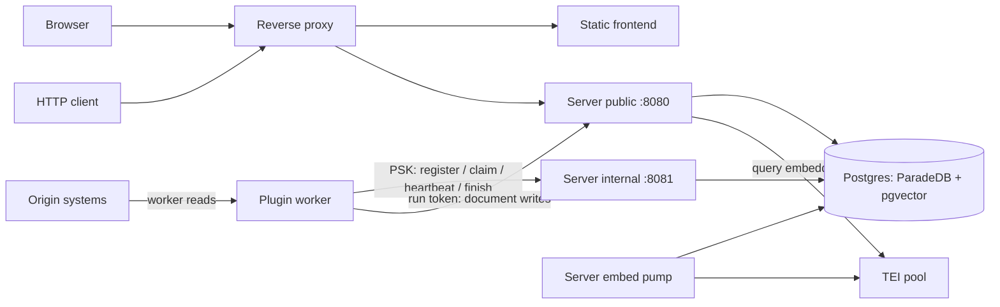

# Architecture

Ferret is a search copy, not a replacement for its origins. Plugins and HTTP ingesters copy text into the index; search returns a matching passage and an origin URL. The origin still owns editing, binary assets and its own authorization.

## Components and ownership

- **Frontend:** a statically exported Next.js app, served by nginx. It talks to `/graphql` using the browser session and `/auth` for login/password/logout. It is not a separate authorization service.
- **Server:** Rust/axum process with public and internal listeners. It applies migrations, bootstraps users, authorizes requests, stores/chunks documents, executes search, manages connection schedules and records Activity. GraphQL and REST reuse the same domain code.
- **Plugin workers:** independent Rust processes that advertise plugin schemas and pull due work. No inbound webhook or worker service is required. A worker reaches the origin, receives credentials only for its claimed run, and ingests using the public API with a source-limited run token.
- **Postgres:** the persistent store for users, sessions, keys, encrypted connection credentials, runs/cursors, documents, chunks, BM25 indexes, model vectors/cache, failures, TEI switches and judgments. ParadeDB and pgvector are requirements, not optional remote search services.
- **TEI pool:** model-serving endpoints discovered through `/info`. TEIs can answer queries, embed backlog, or both. The server runs the pump; a TEI does not independently enumerate Ferret documents.
- **Proxy:** routes static pages to the frontend and `/graphql`, `/auth`, `/api`, `/mcp` to the public server. Internal port 8081 stays private. [MCP](api/mcp.md) exposes read-only search/document/source tools using scoped API keys.

## Data flows

### Ingestion

An HTTP producer authenticates with an API key; a plugin uses its live run token. A put checks user/source ownership and exclusions, computes document change identity, updates text and chunk rows transactionally, and records writer activity. Unchanged puts mark the document seen without rewriting chunks. Full-listing producers use sync/seen/commit to sweep absent documents. See [ingestion](ingestion.md), [indexing](indexing.md) and [plugin contract](plugins/README.md).

The pump observes pending chunks, claims bounded work with database advisory locks and sends title/chunk inputs to an eligible TEI. Ingestion does not wait for this network call. The same database coordinates multiple server pumps and run claims. Missing notifications are recovered by polling/reconnecting, not by requiring a separate message broker.

### Search

The caller's user and source restrictions narrow the corpus. Query parsing separates positive words, phrases and exclusions. Keyword search reads the BM25 chunk index; semantic search embeds the positive query and finds model-specific vector neighbors. Hybrid fuses ranks before selecting the best chunk per document and optionally the best document per thread. [Search](search.md) explains bounded candidates and partial results.

### Connections

Creation makes a connection due. A registered worker claims it, receives the previous successful state and a token, heartbeats while running, then reports outcome and new state. Expired leases produce lost runs. Origin writes are incremental, not rolled back if the run later fails. [Connections](connections.md) is the user guide; [plugins](plugins/README.md) is the wire/implementation contract.

## Boundaries and failure domains

Public credentials are deliberately separate: session cookies for UI GraphQL, scoped API keys/run tokens for REST, shared worker PSK for the private worker surface. Database user isolation is enforced by application queries; the server and database operator remain trusted. A compromised worker/PSK is broader than a compromised single API key. See [auth](auth.md).

Database failure affects health and request handling. TEI failure does not stop document ingestion or keyword search: hybrid degrades explicitly and semantic-only search fails. Origin failure fails a run without committing an incomplete enumeration. The static UI may still load while server APIs fail. These are distinct health signals.

Source map: [startup](../crates/ferret-server/src/main.rs), [routers](../crates/ferret-server/src/lib.rs), [GraphQL](../crates/ferret-server/src/graphql.rs), [workers](../crates/ferret-plugins/src/worker.rs), [migrations](../crates/ferret-server/migrations/), [proxy](../docker/traefik-dynamic.yml). For rationale rather than current procedure, see [ADRs](adr/) and [conception](conception/README.md).
