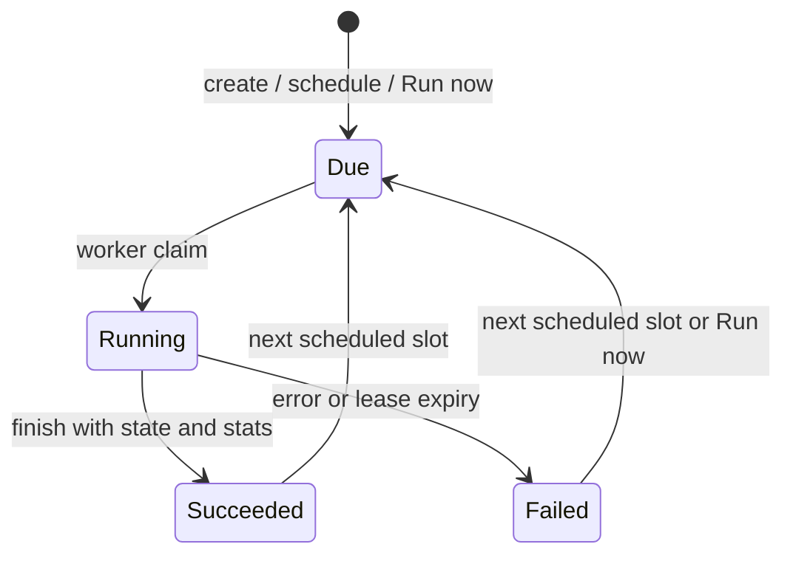

# Connections

A connection configures one plugin for one origin and owns a source root. The server schedules runs; a separately running worker reads the origin and writes documents. HTTP ingesters do not need a connection.

## Create and configure

Sign in and open **Connections**, then create a connection. Choose a registered plugin, a human-readable name and icon, a source root, a cron schedule, and the plugin fields. The form comes from the worker's JSON Schema. If no worker has registered a plugin, the server cannot create a connection of that type.

Use a root such as `notes/work` or `mail/personal`: nonempty slash-separated segments, no leading/trailing/doubled slash or surrounding whitespace. Roots compare by whole segments: `notes` covers `notes/work`, not `notes-old`.

A user's connection roots cannot overlap. Creation also rejects documents already below the new root. Ordinary API keys cannot write inside a connection's root, or start a sweep above it. This prevents another writer's sweep from deleting plugin-owned documents. Users have separate namespaces.

Use the appropriate setup guide: [git](plugins/git.md), [Gitea](plugins/gitea.md), [Paperless](plugins/paperless.md), [carapace](plugins/carapace.md), [IMAP](plugins/imap.md), [AFFiNE](plugins/affine.md), [Vikunja](plugins/vikunja.md). Examples there are plugin configuration objects, not entire connection requests. In the UI enter their fields individually. A source is not an origin credential or remote folder.

## Schedule and run lifecycle

Schedules are five-field cron expressions evaluated in UTC, for example `0 * * * *` hourly or `*/15 * * * *` every fifteen minutes. Creation makes the first run due now. Changing the schedule computes the next slot from the current time. **Run now** makes an enabled connection due; a worker must still claim it.

Only one live run of a connection is claimed at a time. Workers heartbeat their lease; an expired run fails and its run token stops authorizing writes. A successful finish saves the plugin cursor for the next run. A failed run may already have written documents: runs are not one transaction over the origin. After a failed or lost run, the next claim receives empty working state so the plugin fully reconciles potentially partial writes. The stored successful cursor remains unchanged until another run succeeds. Plugins commit a sweep only after a successful enumeration, preserving documents when enumeration fails.

## Activity and troubleshooting

**Connections** shows recent runs and allows **Run now**, edit, enable/disable and delete. **Activity** shows ingestion and plugin-run activity, logs, counts and errors, along with embedding progress. A completed run and completed embedding backfill are distinct milestones: keyword search can find newly indexed chunks before embeddings finish.

- Due with no run: check worker registration, shared worker secret and internal server reachability.
- Failed: read the run error and log before retrying. Check origin credentials, worker DNS/TLS, and the plugin's limitations.
- Succeeded but no hits: verify source/filter choices, exclusions and plugin selection rules; try keyword search while embeddings catch up.

## Credentials and changes

Secret fields are write-only. The server encrypts them separately from non-secret configuration and releases them to a worker only for a claimed run. Editing non-secret configuration requires re-entering stored credentials, so changing the remote cannot forward a hidden token to an attacker-controlled origin. A schedule-only or enabled-only change preserves them. Setting a credential to null removes it.

The plugin and source root are not editable. To change ownership, create a different connection at a fresh root or deliberately delete the old connection and its indexed documents.

## Exclude, disable, delete

Excluding a connection-owned document or thread removes its indexed documents and remembers the exclusion on the connection, so later puts cannot restore them. Removing that exclusion resets the connection's cursor: its next run starts from scratch and can restore unchanged origin documents too. Wait for a running connection to finish before removing an exclusion. Documents written by API keys have no owning connection: the UI removes them but cannot remember an exclusion, so the ingester may write them again.

**Disable** prevents future claims but retains the connection, documents and history. It is not an immediate cancellation of a worker already processing a run. **Delete** requires typing the source root and deletes every indexed document below it, the connection and its runs. Deleting the connection ends its live token. Neither action changes the origin.

Implementation: [connections](../crates/ferret-server/src/connections.rs), [runs](../crates/ferret-server/src/runs.rs), [exclusions](../crates/ferret-server/src/exclusions.rs), [UI](../frontend/src/components/connections.tsx).
