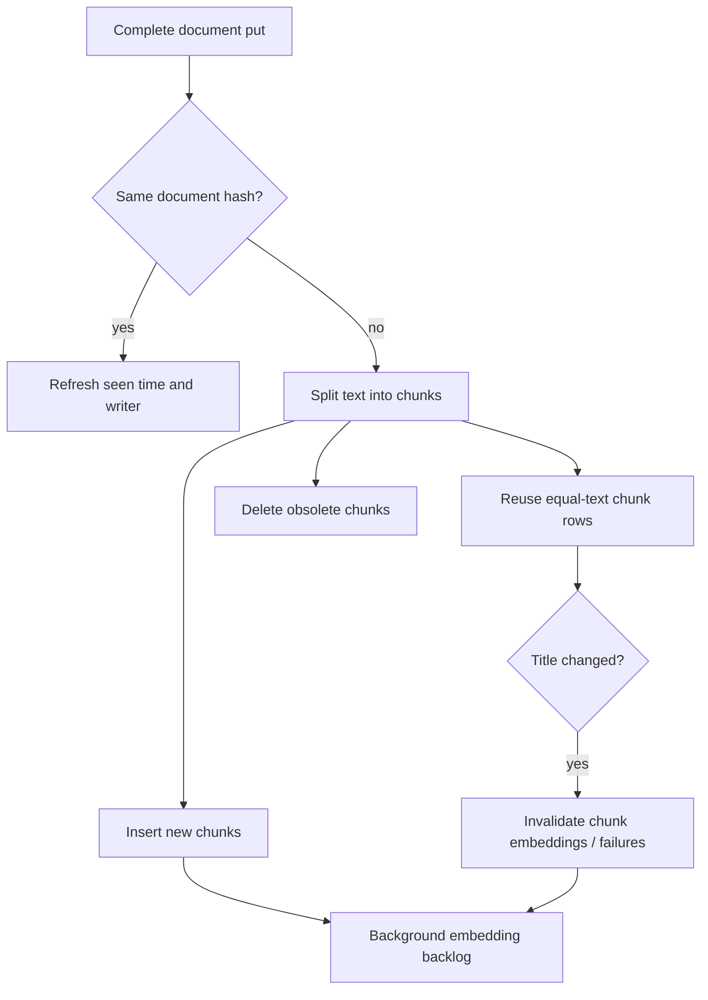

# Indexing and derived data

A document is the complete searchable text and metadata of one origin item. A chunk is a bounded passage used for matching and snippets. Ferret stores the full document and derives chunks, keyword index entries and model embeddings; these are different lifecycles.

## Storage and identity

Documents are unique by `(user_id, source, external_id)` and have a Ferret UUID. Sources are hierarchical paths, while external ids are opaque producer identifiers. Threads group documents only within one exact source. The writer is a connection or API key, not an author: authors describe the content; writers describe how it entered Ferret.

A put hashes the serialized complete document with SHA-256. An identical hash updates `seen_at` and the API-key writer but does not rechunk. Any changed field, including metadata/timestamps, produces an updated document. The existing UUID stays stable. This is a complete upsert, not a patch or an origin-version conflict check. See [HTTP ingestion](ingestion.md).

Origin creation and modification dates are independently nullable. Unknown dates are not ingestion timestamps and never use epoch sentinels. `chunks.ts` and `chunk_embeddings.ts` preserve the document's nullable creation date, including on reused chunks/embeddings when a put changes known to unknown or unknown to known. A date-only change updates these denormalized fields without recomputing unchanged embedding inputs. Identical complete puts containing null dates remain unchanged.

## Chunk construction

Markdown splitting respects headings/paragraph structure; plain text and email split by paragraph/line and smaller semantic units as needed. Chunks aim for 1000 to 2000 characters, with a maximum of 2000 Unicode scalar values, not tokens or UTF-8 bytes. Short documents can have shorter chunks; empty/whitespace-only text has none. Each chunk stores character start/end offsets into the original text so the viewer can highlight the right passage.

When a document changes, text hashes match existing chunk rows where possible, even if their position moved. Reused chunks keep ids and embeddings while ordinal, offsets, source, title and filter metadata are refreshed. Repeated identical passages use separate reusable rows. Stale chunks are deleted; new passages get new ids. A title change deletes embeddings and recorded embedding failures for reused chunks because the embedded input includes the title.

## Keyword and vector indexes

The ParadeDB BM25 index covers chunk text and title in German-stemmed, English-stemmed and trigram forms, along with filter columns. A word may match one form while another word matches another form. Titles are repeated on chunks so title matches can find a document even when a particular passage lacks that word. Empty documents have no searchable chunk, even if they have a title.

`chunk_embeddings` stores one half-precision vector per chunk/model, with denormalized user/source/filter data. Startup creates a model-specific partial HNSW cosine index with the configured dimension. The shared `embedding_cache` is keyed by model and hash of the exact prefixed input, for both documents and queries. It is not the live document corpus and is shared across users. `embedding_models` registers every model with stored vectors and its dimension; vector, cache and failure rows reference it and are deleted with it when an admin deletes a model that is no longer configured ([stored embeddings](embeddings.md#stored-embeddings-and-the-model-registry)). [Embeddings](embeddings.md) describes model identity and pump behavior.

Search is over bounded chunk candidates, not a full ranking of every document. It selects one best fused passage per document, then optionally collapses threads. [Search](search.md) owns the retrieval behavior.

## Writer statistics and estimated storage

Activity's **Index usage** table sits below the ingest feed and describes current indexed content,
not cumulative run or API-burst counters. A document belongs to the connection whose root covers
its source, otherwise to the API key that last put it. Revoked keys retain their identity. An
unchanged put by another key can therefore move the document, its chunks and its stored embeddings
between rows. Retained documents without writer metadata appear as **Unknown writer**.

Each document and chunk counts once, across exact source paths, without summing overlapping
parent/child source facets. Multiple embedding models do not multiply those counts. A document
without chunks still contributes its document row and document-index allocation. Writer details
list the associated exact source paths.

Count percentages use the signed-in user's whole-index document or chunk total. Storage
percentages use that user's total under the same estimation rules. The ingest-feed writer filter
and the admin all-user switch do not change these rows or denominators. Empty totals use 0%.
Counts reveal their percentages on hover or keyboard focus; native expandable writer/storage
details work with keyboard, pointer and touch.

**Estimated storage** adds:

- **Documents:** a PostgreSQL row-size estimate of full text, metadata and every other document
  field, including tuple-header overhead and a four-byte heap line pointer.
- **Chunks:** the same estimate for chunk text, repeated titles/metadata and other chunk fields.
- **Embeddings:** estimated complete stored embedding rows, including their filter columns and
  row overhead, across every stored model, configured or not. Details show each model's stored
  count, estimated row bytes and attributed HNSW bytes.
- **Indexes:** current PostgreSQL relation sizes allocated across all users' current content.
  Shared document/chunk indexes are allocated by the writer's fraction of their respective row
  counts. Shared embedding indexes other than HNSW are allocated by embedding row count.
  BM25 is allocated by UTF-8 bytes of chunk text plus repeated chunk titles. Each model's HNSW
  index is allocated by the writer's fraction of that model's stored embeddings. A zero
  denominator allocates zero bytes. User totals add only that user's shares, not the entire
  shared indexes.

The migration backfills row estimates once. Database triggers maintain them when stored content
changes; generated chunk text-byte counts track text/title changes. Seen-time/API-key-only
updates reuse document size estimates, but attribution is resolved afresh on snapshot refresh.
Visible Activity tabs poll every five seconds. The server shares each user's complete
repeatable-read snapshot for five seconds, including the global counts used for allocation, so
concurrent tabs do not each rescan the content tables. A refresh reads numeric sizes and counts,
not full document/chunk content or vectors for sizing. This is still an aggregate over current
rows, not a constant-time counter or a cached ingestion total.

These are attribution estimates, **not exact physical disk usage or bytes reclaimed by deletion**.
Row estimates precede final TOAST compression/page placement and do not account for heap free
space, dead tuples, page padding, TOAST bookkeeping, visibility/free-space maps or maintenance
effects. Allocated physical indexes can retain free space after deletion and their allocation
changes with other current content. Non-content tables (users, connections, runs, sessions,
embedding failures/errors), WAL and backups are excluded.

The **shared embedding cache is excluded**: it spans writers/users, includes query vectors and
survives document deletion. Original files and binary assets remain at the origin and are not
stored by Ferret. Admin's existing per-model stored-embedding view is separate and unchanged.

## Deletion, exclusions and rebuild boundaries

Deleting a document cascades to chunks, per-chunk embeddings/failures and its judgments. A normal sync sweeps unseen documents below its root; an optional thread scope instead sweeps only that exact source/thread. Excluding a connection document/thread deletes its copies and remembers the exclusion on the connection; removing it resets the plugin state for a fresh run. API-key documents have no remembered connection exclusion. A connection's generic namespace-flattening operation atomically relocates its document and exclusion identities while preserving UUIDs and content; it does not sweep or imply a successful import. Deleting a connection deletes its root's documents and run history, not origin content.

The cross-user embedding cache is not cascaded with document deletion. Consequently deleting a source is not a promise of immediate removal of all derived cached vectors or backup copies. Operators handling erasure requirements must account for the database, cache and backups as separate retained data. Deleting a model's stored embeddings in Admin does remove all of its cached vectors.

There is no public “rebuild every index” REST endpoint. Database migrations own schema/index changes; plugin state and stable document identities own resynchronization. Do not delete database rows or change model identity in place as a casual repair procedure. The one supported bulk deletion of derived data is Admin's delete of a model that is no longer configured ([stored embeddings](embeddings.md#stored-embeddings-and-the-model-registry)). Back up before operational repair and use the existing ingestion/run contracts rather than manufacturing chunk rows.

Implementation: [documents](../crates/ferret-server/src/documents.rs), [chunker](../crates/ferret-server/src/chunking.rs), [migrations](../crates/ferret-server/migrations/), [embedding storage](../crates/ferret-server/src/embeddings.rs), [exclusions](../crates/ferret-server/src/exclusions.rs).
