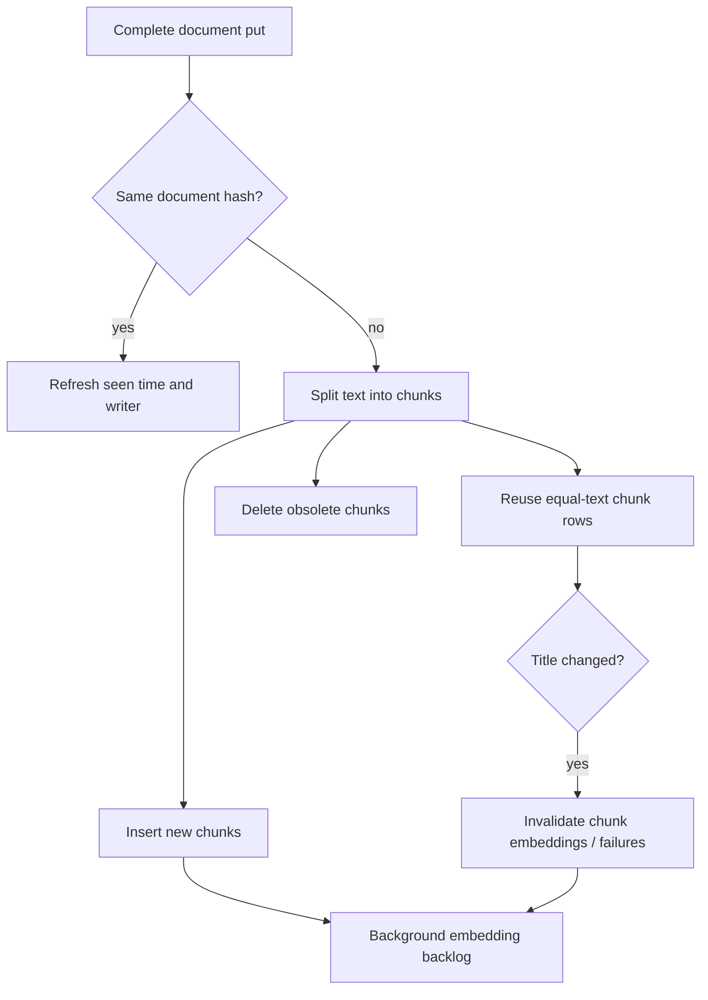

# Indexing and derived data

A document is the complete searchable text and metadata of one origin item. A chunk is a bounded passage used for matching and snippets. Ferret stores the full document and derives chunks, keyword index entries and model embeddings; these are different lifecycles.

## Storage and identity

Documents are unique by `(user_id, source, external_id)` and have a Ferret UUID. Sources are hierarchical paths, while external ids are opaque producer identifiers. Threads group documents only within one exact source. The writer is a connection or API key, not an author: authors describe the content; writers describe how it entered Ferret.

A put hashes the serialized complete document with SHA-256. An identical hash updates `seen_at` and the API-key writer but does not rechunk. Any changed field, including metadata/timestamps, produces an updated document. The existing UUID stays stable. This is a complete upsert, not a patch or an origin-version conflict check. See [HTTP ingestion](ingestion.md).

## Chunk construction

Markdown splitting respects headings/paragraph structure; plain text and email split by paragraph/line and smaller semantic units as needed. Chunks aim for 1000 to 2000 characters, with a maximum of 2000 Unicode scalar values, not tokens or UTF-8 bytes. Short documents can have shorter chunks; empty/whitespace-only text has none. Each chunk stores character start/end offsets into the original text so the viewer can highlight the right passage.

When a document changes, text hashes match existing chunk rows where possible, even if their position moved. Reused chunks keep ids and embeddings while ordinal, offsets, source, title and filter metadata are refreshed. Repeated identical passages use separate reusable rows. Stale chunks are deleted; new passages get new ids. A title change deletes embeddings and recorded embedding failures for reused chunks because the embedded input includes the title.

## Keyword and vector indexes

The ParadeDB BM25 index covers chunk text and title in German-stemmed, English-stemmed and trigram forms, along with filter columns. A word may match one form while another word matches another form. Titles are repeated on chunks so title matches can find a document even when a particular passage lacks that word. Empty documents have no searchable chunk, even if they have a title.

`chunk_embeddings` stores one half-precision vector per chunk/model, with denormalized user/source/filter data. Startup creates a model-specific partial HNSW cosine index with the configured dimension. The shared `embedding_cache` is keyed by model and hash of the exact prefixed input, for both documents and queries. It is not the live document corpus and is shared across users. [Embeddings](embeddings.md) describes model identity and pump behavior.

Search is over bounded chunk candidates, not a full ranking of every document. It selects one best fused passage per document, then optionally collapses threads. [Search](search.md) owns the retrieval behavior.

## Deletion, exclusions and rebuild boundaries

Deleting a document cascades to chunks, per-chunk embeddings/failures and its judgments. Sweeping a sync applies the same document deletion to unseen items below its root. Excluding a connection document/thread deletes its copies and remembers the exclusion on the connection; removing it resets the plugin state for a fresh run. API-key documents have no remembered connection exclusion. Deleting a connection deletes its root's documents and run history, not origin content.

The cross-user embedding cache is not cascaded with document deletion. Consequently deleting a source is not a promise of immediate removal of all derived cached vectors or backup copies. Operators handling erasure requirements must account for the database, cache and backups as separate retained data.

There is no public “rebuild every index” REST endpoint. Database migrations own schema/index changes; plugin state and stable document identities own resynchronization. Do not delete database rows or change model identity in place as a casual repair procedure. Back up before operational repair and use the existing ingestion/run contracts rather than manufacturing chunk rows.

Implementation: [documents](../crates/ferret-server/src/documents.rs), [chunker](../crates/ferret-server/src/chunking.rs), [migrations](../crates/ferret-server/migrations/), [embedding storage](../crates/ferret-server/src/embeddings.rs), [exclusions](../crates/ferret-server/src/exclusions.rs).
